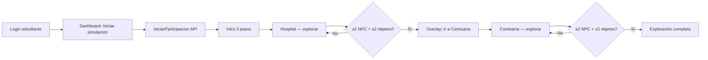

# Informe técnico — Fase C

**Proyecto:** Simulador de decisiones psicosociales (módulo estudiante)  
**Fecha:** 2026-06-03  
**Estado:** Fase C completada — **pendiente aprobación explícita antes de Fase D**

---

## 1. Objetivo de Fase C

Convertir la simulación en una **experiencia de investigación previa** a la toma de decisiones: exploración narrativa, NPCs, objetos, pistas, bitácora y gating mínimo. **Sin** decisiones, consecuencias, `responder()`, minijuegos ni `finalizar()`.

---

## 2. Alcance implementado

| Requisito | Estado |
|-----------|--------|
| Intro narrativa breve antes del hospital | ✅ |
| Hospital: NPCs Madre, Hermano, Médico | ✅ |
| Hospital: Historia clínica, Protocolo EPICEE | ✅ |
| Comisaría: Víctima, Comisario, Trabajador Social | ✅ |
| Comisaría: Expediente, Ruta de protección, Documentos | ✅ |
| Sistema de pistas + contador | ✅ |
| Gating: ≥2 NPCs y ≥2 objetos por escenario | ✅ |
| Bitácora visible (NPC, objeto, información) | ✅ |
| Canvas: movimiento WASD/flechas, interacción E/clic | ✅ |
| API `iniciarParticipacion()` sin cambios backend | ✅ |
| Decisiones / `responder()` / `finalizar()` | ❌ (Fase D) |

---

## 3. Flujo del estudiante



**Ruta:** `/estudiante/simulacion` → `Simulacion` → `SimulacionPlayComponent`.

---

## 4. Arquitectura frontend (Fase C)

```
frontend/src/app/estudiante/
├── simulacion.ts                    # Wrapper lazy → SimulacionPlayComponent
└── simulacion-play/
    ├── simulacion-play.component.*  # UI: intro, HUD, canvas, bitácora, gates
    ├── data/
    │   ├── scene-types.ts           # PlaySceneConfig, EXPLORATION_GATING
    │   ├── intro.content.ts         # 3 pasos narrativos
    │   ├── hospital-scene.content.ts
    │   └── comisaria-scene.content.ts
    ├── services/
    │   ├── investigation.service.ts # Pistas, bitácora, progreso por escena
    │   └── simulacion-play-bridge.service.ts
    └── engine/
        ├── play-scene.engine.ts     # Canvas, hospital + comisaría
        ├── play-player.ts
        └── play-types.ts
```

**Servicios clave**

- `InvestigationService`: registra NPC/objeto una vez por escena; cada interacción añade entradas de pista (`clues` en contenido); expone `clueCount`, `hospitalProgress`, `comisariaProgress`, `hospitalComplete`, `comisariaComplete`.
- `PlaySceneEngine`: dibuja escenario, colisiones simples, hotspots NPC/objeto, pausa durante diálogo.

**Fases internas (`PlayPhase`)**

| Fase | Descripción |
|------|-------------|
| `intro` | Pantalla textual, sin canvas |
| `explore` | Hospital o comisaría activa |
| `gate-hospital` | Overlay al cumplir gating hospital |
| `complete` | Ambos escenarios explorados (sin decisiones) |

---

## 5. Gating de exploración

Constantes en `scene-types.ts`:

```typescript
EXPLORATION_GATING = { minNpcs: 2, minObjects: 2 }
```

- Progreso mostrado en HUD: `NPC x/2`, `Objetos x/2`.
- Al completar hospital → overlay bloquea avance hasta pulsar **Ir a Comisaría de Familia** (no hay botón de “decidir” ni “finalizar capítulo”).
- Al completar comisaría → pantalla **Exploración completa** con enlace al dashboard.

---

## 6. Contenido narrativo (resumen)

### Intro (`intro.content.ts`)

Tres pasos: derivación desde comisaría, urgencia hospitalaria, rol del estudiante como observador/investigador.

### Hospital

| Tipo | ID | Pistas ejemplo |
|------|-----|----------------|
| NPC | madre | Testimonio familiar, riesgos en el hogar |
| NPC | hermano | Perspectiva del hermano, antecedentes |
| NPC | medico | Información médica, valoración clínica |
| Objeto | historia-clinica | Antecedentes, lesiones documentadas |
| Objeto | protocolo-epicee | Marco EPICEE, criterios de valoración |

### Comisaría

| Tipo | ID | Pistas ejemplo |
|------|-----|----------------|
| NPC | victima | Testimonio directo |
| NPC | comisario | Antecedentes administrativos |
| NPC | trabajador-social | Valoración psicosocial |
| Objeto | expediente | Historial del caso |
| Objeto | ruta-proteccion | Medidas de protección |
| Objeto | documentos | Documentación relevante |

Cada `clue` genera una fila en bitácora con `category`, `title`, `summary`.

---

## 7. Interfaz visible

- **Intro:** panel oscuro, pasos 1/3, botón Continuar / Entrar al hospital.
- **HUD:** escenario, subtítulo, contador de pistas, progreso NPC/objetos, temporizador (desde participación + `simulador.practica_activa`).
- **Canvas:** área de juego con leyenda WASD / E / clic.
- **Bitácora lateral:** lista cronológica de entradas; aviso de investigación mínima.
- **Diálogo:** modal inferior al interactuar; al cerrar registra pistas y muestra snackbar.
- **Overlays:** transición hospital → comisaría; mensaje final de exploración.

---

## 8. Archivos creados o modificados (Fase C)

### Nuevos

- `simulacion-play/data/scene-types.ts`
- `simulacion-play/data/intro.content.ts`
- `simulacion-play/data/comisaria-scene.content.ts`
- `simulacion-play/services/investigation.service.ts`

### Modificados / ampliados

- `simulacion-play/data/hospital-scene.content.ts` (3 NPCs, 2 objetos, clues)
- `simulacion-play/engine/play-scene.engine.ts` (`loadScene`, comisaría)
- `simulacion-play/simulacion-play.component.ts` (fases, intro, gating)
- `simulacion-play/simulacion-play.component.html`
- `simulacion-play/simulacion-play.component.scss`
- `simulacion-play/services/simulacion-play-bridge.service.ts`

### Sin cambios (restricción de proyecto)

- Backend Django, APIs, modelos, admin, docente, autenticación.
- `SimulacionService.responder()`, flujo `finalizar()` / resultado enriquecido.

---

## 9. Verificación

```bash
cd frontend
npm run build -- --configuration docker
```

**Resultado:** build exitoso (2026-06-03).

### Plan de prueba manual

1. Acceder como estudiante → **Iniciar simulación**.
2. Leer intro (3 pasos) → **Entrar al hospital**.
3. Mover personaje; hablar con ≥2 NPCs e inspeccionar ≥2 objetos.
4. Confirmar contador de pistas y entradas en bitácora.
5. Ver overlay **Hospital investigado** → **Ir a Comisaría**.
6. Repetir exploración en comisaría.
7. Ver **Exploración completa**; confirmar que no aparecen decisiones ni envío de respuestas.

---

## 10. Limitaciones conocidas

| Tema | Detalle |
|------|---------|
| Comisaría “completa” | Escenario exploratorio en canvas; sin minijuegos ni capítulo administrativo profundo (Fase D+). |
| Persistencia de pistas | Solo en memoria de sesión; no se envían al backend en Fase C. |
| `gate-comisaria` | Tipo definido pero no usado; transición hospital→comisaría vía `gate-hospital` + `explore`. |
| `resultado.ts` | Sigue usando `localStorage.clear()` al cargar (issue previo, fuera de Fase C). |
| Repetir interacción | Mismo NPC/objeto no duplica pistas (idempotente por clave). |

---

## 11. Pendiente — Fase D (requiere aprobación)

- Overlay de **decisiones** vinculadas a preguntas del backend.
- `SimulacionService.responder()` y validación.
- Consecuencias narrativas según respuesta.
- Minijuegos (línea de tiempo, ruta, clasificación de riesgo).
- `finalizar()` y pantalla de resultado integrada.
- Escenario de comisaría ampliado si aplica al guion académico.

---

## 12. Solicitud de cierre

Fase C entrega exploración investigativa completa **sin** toma de decisiones.  
**No se iniciará Fase D hasta recibir aprobación explícita del usuario.**
