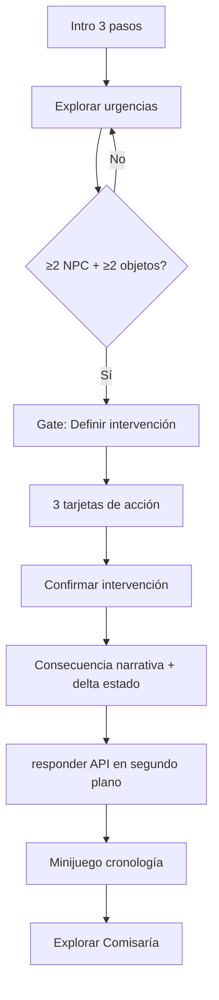
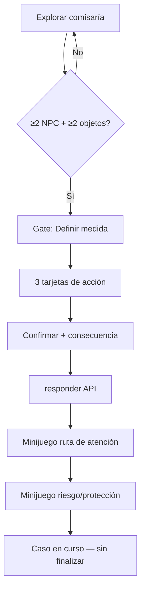

# Informe técnico — Fase D

**Proyecto:** Simulador de decisiones psicosociales (módulo estudiante)  
**Fecha:** 2026-06-03  
**Estado:** Fase D completada — **pendiente aprobación explícita antes de cierre final (Fase E)**

---

## 1. Objetivo de Fase D

Implementar **toma de decisiones profesionales** integrada a la exploración (Fase C), con:

- Acciones narrativas (no cuestionario, sin radios visibles).
- Consecuencias inmediatas contextualizadas.
- Integración invisible con `responder()` del backend.
- Tres minijuegos embebidos en el flujo.
- Estado narrativo local (4 ejes, sin XP global).
- **Sin** `finalizar()` ni pantalla de resultado final.

---

## 2. Alcance implementado

| Requisito | Estado |
|-----------|--------|
| Decisión hospital tras exploración completa | ✅ |
| Decisión comisaría tras exploración completa | ✅ |
| Tarjetas de acción profesional (no radios) | ✅ |
| Confirmación + consecuencias narrativas | ✅ |
| `responder()` tras confirmar (IDs ocultos) | ✅ |
| Minijuego cronología | ✅ |
| Minijuego ruta de atención | ✅ |
| Minijuego clasificación riesgo/protección | ✅ |
| Estado narrativo (4 variables) | ✅ |
| Participación abierta al final | ✅ |
| `finalizar()` / resultado final | ❌ (Fase E) |

---

## 3. Flujo completo — Hospital



**NPCs/objetos hospital:** Madre, Hermano, Médico, Historia clínica, Protocolo EPICEE.

**Decisiones narrativas (ejemplo):**

1. Activar protocolo de atención integral  
2. Priorizar entrevista familiar  
3. Esperar nueva valoración médica  

---

## 4. Flujo completo — Comisaría



**NPCs/objetos comisaría:** Víctima, Comisario, Trabajador Social, Expediente, Ruta de protección, Documentos.

---

## 5. Integración de `responder()` (invisible)

### Servicio: `DecisionBridgeService`

Resuelve `pregunta_id` y `respuesta_id` a partir del caso cargado en `Participacion.caso`:

| Escena narrativa | `escenarioOrden` | `preguntaOrden` | `respuestaOrden` |
|------------------|------------------|-----------------|------------------|
| Hospital | 1 | 1 | 1, 2 o 3 según opción |
| Comisaría | 2 | 1 | 1, 2 o 3 según opción |

El estudiante **nunca** ve enunciados ni IDs. Tras pulsar **Confirmar intervención**:

```typescript
this.simulacion.responder(part.id, ref.pregunta_id, ref.respuesta_id)
```

Si el caso no trae escenarios/preguntas alineados por orden, la narrativa continúa y se muestra aviso discreto (sin bloquear el flujo).

### Mapeo opción → backend

Definido en `decisions.content.ts` por `respuestaOrden` en cada `DecisionOptionDef`.

---

## 6. Consecuencias y estado narrativo

### Consecuencias

Cada opción incluye:

- `consequenceTitle` + `consequenceLines`
- `narrativeFeedback` (retroalimentación contextual, no “correcto/incorrecto”)
- Ajuste de ejes vía `delta`

### `NarrativeStateService` (solo simulación)

| Eje | Clave | Rango |
|-----|-------|-------|
| Confianza Familiar | `confianzaFamiliar` | 0–100 |
| Protección de Derechos | `proteccionDerechos` | 0–100 |
| Calidad de Intervención | `calidadIntervencion` | 0–100 |
| Riesgo de Revictimización | `riesgoRevictimizacion` | 0–100 (menor es mejor) |

Visible en panel lateral con barras de progreso. Los minijuegos aplican bonificación proporcional al puntaje (`applyMinigameBonus`).

**No** hay XP global, niveles ni logros.

---

## 7. Minijuegos (flujo narrativo)

| Orden | Componente | Momento |
|-------|------------|---------|
| 1 | `TimelineMinigameComponent` | Tras decisión hospital |
| 2 | `RouteMinigameComponent` | Tras decisión comisaría |
| 3 | `RiskMinigameComponent` | Tras ruta |

Introducción textual en overlay (“El equipo te pide…”) para integrarlos al caso, no como módulos aislados del menú.

---

## 8. Archivos creados (Fase D)

| Archivo |
|---------|
| `simulacion-play/data/decisions.content.ts` |
| `simulacion-play/data/minigames.content.ts` |
| `simulacion-play/services/decision-bridge.service.ts` |
| `simulacion-play/services/narrative-state.service.ts` |
| `simulacion-play/minigames/timeline-minigame.component.ts` |
| `simulacion-play/minigames/route-minigame.component.ts` |
| `simulacion-play/minigames/risk-minigame.component.ts` |
| `docs/INFORME_TECNICO_FASE_D.md` |

---

## 9. Archivos modificados (Fase D)

| Archivo | Cambio principal |
|---------|------------------|
| `simulacion-play/simulacion-play.component.ts` | Fases D, decisiones, API, minijuegos |
| `simulacion-play/simulacion-play.component.html` | UI acciones, consecuencias, minijuegos, estado |
| `simulacion-play/simulacion-play.component.scss` | Estilos tarjetas, consecuencias, minijuegos |

**Sin cambios:** backend Django, APIs nuevas, admin, docente, auth.

---

## 10. Fases internas (`PlayPhase`)

| Fase | Descripción |
|------|-------------|
| `intro` | Contexto del caso |
| `explore` | Canvas hospital o comisaría |
| `gate-hospital` / `gate-comisaria` | Exploración mínima cumplida |
| `decision-*` | Elección de acción profesional |
| `confirm-*` | Confirmación explícita |
| `consequence-*` | Retroalimentación narrativa |
| `minigame-timeline` / `route` / `risk` | Ejercicios de análisis |
| `case-continues` | Fin Fase D — participación abierta |

---

## 11. Verificación

```bash
cd frontend
npm run build -- --configuration docker
```

**Resultado:** build exitoso (2026-06-03).

### Prueba manual sugerida

1. Iniciar simulación → intro → hospital → explorar todo.  
2. Definir intervención → confirmar → leer consecuencia.  
3. Completar cronología → comisaría → explorar.  
4. Decisión comisaría → ruta → clasificación riesgo.  
5. Pantalla **Caso en curso** (sin botón finalizar).  
6. Verificar en red (DevTools) llamada POST a `/responder/` solo tras confirmar.  

---

## 12. Pendiente — Fase E (cierre final)

Requiere **aprobación explícita** del usuario:

| Ítem | Descripción |
|------|-------------|
| `finalizar()` | Cerrar participación y calcular resultado |
| Pantalla `/estudiante/resultado/:id` | Integrada al flujo post-simulación |
| Evitar `localStorage.clear()` agresivo en resultado | Issue conocido |
| Ajuste fino mapeo `escenarioOrden` | Si el caso académico usa otro orden de escenarios |
| Persistencia estado narrativo | Opcional en backend o localStorage de sesión |

---

## 13. Solicitud de cierre

Fase D entrega exploración + decisiones + minijuegos + `responder()` invisible, **sin** cierre oficial de práctica.

**No se iniciará Fase E hasta recibir aprobación explícita.**
