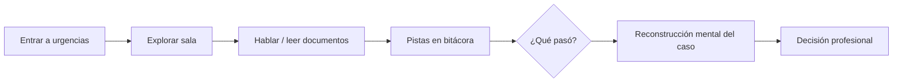

# Informe técnico — Fases R0, R1 y R2

**Proyecto:** Simulador de decisiones psicosociales  
**Fecha:** 2026-06-03  
**Estado:** R0 + R1 + R2 implementadas — **esperar aprobación explícita antes de nuevas fases**

---

## 1. Resumen

| Fase | Objetivo | Estado |
|------|----------|--------|
| **R0** | Sin intro expositiva; spawn directo en hospital; HUD tutorial breve | ✅ |
| **R1** | Mundo visible con assets propios (SVG); zonas hospital/comisaría | ✅ |
| **R2** | Descubrimiento jugando; diálogos in-world; pistas progresivas | ✅ |

**Sin cambios:** backend, APIs, `responder()`, `DecisionBridgeService`, minijuegos, decisiones académicas.

---

## 2. R0 — Eliminar intro expositiva

### Antes
- Fase `intro` con 3 pantallas (`intro.content.ts`).
- El estudiante leía el caso completo antes del canvas.

### Ahora
- Fase inicial: `explore` en hospital.
- Tras `iniciarParticipacion()` → `entrarHospital()` automático.
- HUD tutorial flotante sobre el canvas (~4,5 s):
  - `WASD` para moverte
  - `E` para interactuar
- Animación `fadeTutorial` — desaparece sin acción del usuario.

### Archivos
- `simulacion-play.component.ts` — eliminada fase `intro` y `INTRO_STEPS`.
- `simulacion-play.component.html` — bloque intro removido.

---

## 3. R1 — Mundo visible

### Assets propios (sin MemoriasDelParque)

| Asset | Ruta |
|-------|------|
| Fondo hospital | `frontend/public/assets/simulacion/hospital-bg.svg` |
| Fondo comisaría | `frontend/public/assets/simulacion/comisaria-bg.svg` |
| Jugador | `frontend/public/assets/simulacion/player.svg` |
| Objetos/documentos | `frontend/public/assets/simulacion/object-doc.svg` |

### Zonas dibujadas en SVG

**Hospital:** recepción, sala de observación (camas), estación médica, señal URGENCIAS.

**Comisaría:** archivo (estanterías), zona de atención, escritorio, rótulo COMISARÍA DE FAMILIA.

### Motor

| Módulo | Función |
|--------|---------|
| `engine/asset-loader.ts` | Precarga imágenes SVG |
| `engine/scene-renderer.ts` | Fondo, jugador, NPCs con color/etiqueta, objetos, marcador `!`, hint `E` |
| `engine/play-scene.engine.ts` | Escala **cover** (sin bandas negras), loop de juego |

NPCs: personajes con cuerpo de color, cabeza, sombra, halo cyan al acercarse, marcador `!`.

---

## 4. R2 — Descubrimiento inmersivo

### Principio
Ningún párrafo expositivo previo. La primera línea del médico es ambigua; el detalle (arma blanca, menor, EPICEE, amenazas) sale de **interacciones**.

### Reparto de información

| Fuente | Piezas que aporta |
|--------|-------------------|
| **Médico** | Urgencia, mecanismo, menor en hogar, cuidado con revictimización |
| **Madre** | Gritos, agresor furioso, amenazas, control económico |
| **Hermano** | Tensión, cuchillo, custodia de la niña |
| **Historia clínica** | Ingreso, arma blanca, agresor 28 años, barrio vulnerable |
| **Protocolo EPICEE** | Marco evaluación/protección, checklist de riesgo |
| **Víctima** | Miedo, amenazas si denuncia, deseo de protección |
| **Comisario** | Marco legal, violencia intrafamiliar con arma |
| **Trabajador social** | Red limitada, alojamiento, acompañamiento |
| **Expediente** | Llamadas previas sin protección efectiva |
| **Ruta de protección** | Cadena institucional |
| **Documentos** | Reporte médico-legal, menor expuesta |

Cada interacción registra **2 pistas** en bitácora (`InvestigationService` — sin cambios).

### Diálogos in-world

- Componente `presentation/inworld-dialogue.component.ts`.
- Caja sobre el **canvas** (no modal fullscreen).
- Retrato con color del NPC; documentos en tono ámbar.
- Avance con botón / `E` / clic en canvas.

---

## 5. Capturas y referencias visuales

Carpeta: `docs/capturas-r0-r2/`

| # | Archivo | Contenido |
|---|---------|-----------|
| 1 | `01-hospital-referencia.png` | Referencia visual objetivo hospital (ilustración) |
| 2 | `02-comisaria-referencia.png` | Referencia visual comisaría |
| 3 | `03-jugador.svg` | Sprite jugador (profesional teal) |
| 4 | `04-escenario-hospital.svg` | Plano hospital con zonas etiquetadas |
| 5 | `05-objeto-documento.svg` | Icono documento interactivo |

**Captura en vivo:** con `docker-compose up`, ir a `/estudiante/simulacion` → Iniciar simulación. Debe verse el SVG de fondo, personajes y tutorial WASD/E.

---

## 6. Cómo se descubre el caso jugando



1. El estudiante **no** recibe narrativa del barrio ni de la agresión al inicio.
2. Al acercarse al **médico** entiende que hay una paciente crítica.
3. La **madre** y el **hermano** aportan dinámica familiar y secuencia.
4. **Historia clínica** y **EPICEE** objetivan riesgo y marco institucional.
5. En **comisaría**, la víctima y el expediente completan miedo, antecedentes y rutas.
6. La bitácora lateral va armando el puzzle; el subtítulo del HUD invita a **indagar**.

---

## 7. Archivos creados

```
frontend/public/assets/simulacion/
  hospital-bg.svg, comisaria-bg.svg, player.svg, object-doc.svg, npc-generic.svg

frontend/src/app/estudiante/simulacion-play/
  engine/asset-loader.ts
  engine/scene-renderer.ts
  presentation/inworld-dialogue.component.ts

docs/capturas-r0-r2/
docs/INFORME_TECNICO_R0_R1_R2.md
```

---

## 8. Archivos modificados

- `engine/play-scene.engine.ts` — assets + renderer
- `simulacion-play.component.ts/html/scss`
- `data/hospital-scene.content.ts` — diálogos progresivos, subtítulo
- `data/comisaria-scene.content.ts` — idem

`intro.content.ts` queda obsoleto (no referenciado).

---

## 9. Verificación

```bash
cd frontend
npm run build -- --configuration docker
```

Build: **OK** (2026-06-03).

### Checklist manual

- [ ] No aparecen 3 pantallas de intro.
- [ ] Hospital visible al cargar (recepción, camas, escritorio).
- [ ] Jugador y NPCs visibles y etiquetados.
- [ ] Objetos con icono documento y nombre.
- [ ] Tutorial WASD/E visible ~4 s.
- [ ] Diálogo en banda inferior del canvas (no pantalla completa).
- [ ] Bitácora crece al interactuar sin spoilear en intro.

---

## 10. Pendiente (requiere nueva aprobación)

- **R3+** de propuesta original: observables ambientales, NPCs condicionados, decisiones 100% diegéticas.
- **Fase E:** `finalizar()` y resultado (explícitamente no aprobada).
- Mejoras visuales: sprites por NPC, animación walk, audio ambiente.
- Capturas PNG desde navegador en producción (sustituir referencias ilustrativas si se desea pixel-perfect).

---

## 11. Cierre

R0–R2 alinean la simulación con **explorar → descubrir** antes de interpretar/decidir. La capa académica permanece intacta.

**No iniciar nuevas fases sin aprobación explícita del equipo.**
