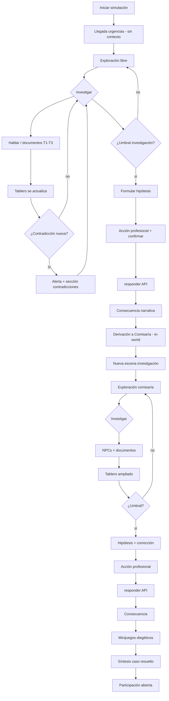

# Plan técnico — Rediseño de máxima inmersión (I0–I6)

**Estado:** APROBADO PLAN COMPLETO I0–I6 — con dirección de diseño revisada (v2)  
**Siguiente paso:** Implementación por oleadas tras este documento  
**Fecha:** 2026-06-03  
**Alcance:** Solo frontend / `simulacion-play`  
**Restricción:** Sin cambios en backend, APIs, auth, docente, admin, `SimulacionService`, `responder()`, `finalizar()`

---

## 0. Principio rector (ajuste aprobado)

> **El objetivo no es tener más NPCs ni más documentos.**  
> **El objetivo es que el estudiante sienta que investiga un caso real.**

Cada personaje u objeto existe solo si aporta **un fragmento distinto** de verdad. Si dos fuentes dicen lo mismo, una sobra. Si una fuente explica “todo el caso” en un diálogo, está mal diseñada.

La métrica de éxito no es “visité 10 lugares”, sino “**reconstruí qué pasó, detecté qué no cuadra y actué como profesional**”.

---

## 1. Las siete prioridades de diseño (orden de implementación)

| # | Prioridad | Qué significa en producto |
|---|-----------|---------------------------|
| **P1** | Descubrimiento fragmentado | Una pista por interacción; frases cortas; nadie con la verdad completa |
| **P2** | Contradicciones centrales | Motor activo; tablero dedicado; el caso no es lineal |
| **P3** | Caso en construcción | Tablero vivo que se actualiza solo; sensación investigación profesional |
| **P4** | Hipótesis | Antes de cada decisión; sin nota; confirmación/corrección después |
| **P5** | Mundo vivo (diálogos T1–T3) | Conversaciones que evolucionan; T3 por pistas previas |
| **P6** | Decisiones profesionales | Acciones nombradas; UI diegética; `responder()` invisible |
| **P7** | Sensación final | Resolver un caso, no completar un cuestionario |

Las oleadas I0–I6 se ordenan siguiendo **P1 → P2 → P3** primero, luego **P4–P7**.

---

## 2. Veredicto sobre la implementación actual

| Problema | Causa técnica |
|----------|---------------|
| Sensación de cuestionario | Overlays `gate-*`, `decision-*`, minijuegos desconectados |
| Historia lineal | Todos los NPCs alineados en la 2.ª línea; sin contradicciones |
| Una visita por NPC | `registerNpc()` idempotente por ID |
| Sin investigación profesional | Bitácora cronológica plana, sin hechos confirmados/pendientes |

**Conservar:** motor canvas, assets SVG, `InworldDialogue`, `DecisionBridgeService`, `responder()`, spawn directo hospital.

**Reemplazar:** modelo de contenido, servicios de investigación, gating, flujo de fases, textos.

---

## 3. Arquitectura frontend (sin cambios de contrato API)

```
simulacion-play/
├── data/investigation/
│   ├── clues.catalog.ts           # Fragmentos atómicos (1 idea = 1 pista)
│   ├── contradictions.catalog.ts  # Pares incompatibles → alerta
│   ├── fact-status.rules.ts       # Qué pista confirma vs deja pendiente
│   ├── hospital.investigation.ts  # Grafos T1–T3 (pocos NPCs, bien diseñados)
│   └── comisaria.investigation.ts
├── services/
│   ├── case-investigation.service.ts   # Tablero Caso en construcción
│   ├── conversation.service.ts         # Niveles NPC, re-dialogo
│   ├── contradiction.service.ts        # Escaneo al añadir pista
│   ├── hypothesis.service.ts           # Hipótesis H/C + confirmación
│   └── decision-bridge.service.ts      # SIN CAMBIOS
└── presentation/
    ├── investigation-board.component.ts
    ├── hypothesis-panel.component.ts
    └── inworld-dialogue.component.ts
```

---

## 4. P1 — Descubrimiento fragmentado

### 4.1 Reglas de escritura (obligatorias)

1. **Máximo 1–2 ideas nuevas** por línea de diálogo.
2. **Prohibido** en T1: violencia intrafamiliar, arma blanca, feminicidio, menor expuesta (salvo ambigüedad tipo “hay un niño en el hogar” sin contexto).
3. Cada fuente con **rol epistémico** claro:

| Fuente | Solo sabe / ve |
|--------|----------------|
| Médico | Cuerpo, signos, gravedad clínica |
| Madre | Emoción, versión parcial, omisiones |
| Hermano | Otra versión, contradicción potencial |
| Guardia | Ingreso, acompañante, hora |
| Enfermería | Comportamiento previo, observación |
| Historia clínica | Datos objetivos escritos |
| EPICEE | Marco, no el relato del hecho |
| Víctima | Experiencia subjetiva, miedo |
| Expediente / denuncias | Registro institucional |
| Comisario | Marco legal, no el relato íntimo |

### 4.2 Inventario mínimo de fuentes (calidad > cantidad)

**Hospital (5 NPC + 2 documentos + 1 ambiental opcional)**

| ID | Función narrativa | Fragmentos únicos |
|----|-------------------|-------------------|
| `medico` | Gravedad clínica | Estado, mecanismo lesión (T2), alerta hogar (T3) |
| `madre` | Versión familiar A | Angustia (T1), conflicto previo evasivo (T2), control/amenazas (T3) |
| `hermano` | Versión familiar B | Llegada tardía (T1), relato incidente (T2), objeto/agresor (T3) |
| `guardia` | Llegada física | Quién entró, quién se fue |
| `enfermeria` | Observación previa | Conducta, señales no verbales |
| `historia-clinica` | Evidencia escrita | Admin T1 / mecanismo T2 |
| `protocolo-epicee` | Marco institucional | Checklist sin rellenar hasta pistas |

**Comisaría (4 NPC + 4 documentos)** — sin inflar cast

| ID | Función |
|----|---------|
| `victima` | Testimonio directo, miedo |
| `comisario` | Institución, medidas |
| `trabajador-social` | Red, plan contención |
| `secretaria` | Archivo, llamadas previas |
| `expediente` | Antecedentes formales |
| `denuncias-previas` | Contradicción institucional |
| `ruta-proteccion` | Qué debería activarse |
| `reporte-policial` | Versión policial del hecho |

*Nota: `funcionario-proteccion` y `registro-atencion` pueden fusionarse en documentos/NPC existentes si no aportan fragmento nuevo.*

### 4.3 Formato de pista

Cada pista = **una oración** en tablero + detalle opcional en registro.

Ejemplos hospital:

- `H-P-01` — “Ingresó una mujer joven en la noche.”
- `H-F-02` — “Un acompañante varón salió del hospital.”
- `H-F-05` — “El mecanismo de lesión es penetrante.” (solo tras historia clínica o médico T2)
- `H-R-03` — “Podría haber una menor en la vivienda.” (ambiguo hasta confirmar)

---

## 5. P2 — Contradicciones como mecánica central

### 5.1 No es decoración

- Al registrar pista B, si existe par `(A,B)` en catálogo → se crea entrada en **Contradicciones encontradas**.
- Banner diegético en canvas: “Detectaste una inconsistencia”.
- Algunos **T2/T3 bloqueados** hasta que el estudiante abra la contradicción (opcional, 1–2 casos).

### 5.2 Matriz principal (hospital)

| ID | Versión A | Versión B | Tema |
|----|-----------|-----------|------|
| `H-C-01` | Madre: “Él llegó después” | Hermano: “Él ya estaba dentro” | Momento del agresor |
| `H-C-02` | Guardia: “Acompañante se fue” | Madre: “Vinimos juntos” | Quién acompañó |
| `H-C-03` | Historia clínica: lesión penetrante | Madre: “fue un empujón” | Gravedad |

### 5.3 Matriz principal (comisaría)

| ID | Versión A | Versión B |
|----|-----------|-----------|
| `C-C-01` | Víctima: “nunca denuncié” | Denuncias previas: radicado |
| `C-C-02` | Comisario: “primer ingreso” | Expediente: llamadas anteriores |

### 5.4 Hechos confirmados vs pendientes (ligado a P3)

- **Confirmado:** pista respaldada por ≥2 fuentes independientes O por documento oficial.
- **Pendiente:** pista de un solo testimonio o en conflicto abierto.
- Cuando se resuelve contradicción (el estudiante visita 3.ª fuente o documento), una pasa a confirmado y la otra queda “descartada” o “pendiente de verificación”.

---

## 6. P3 — Tablero «CASO EN CONSTRUCCIÓN»

### 6.1 Secciones (siempre visibles en lateral)

```
CASO EN CONSTRUCCIÓN
├── Personas involucradas        (tarjetas con rol: víctima, acompañante, familiar…)
├── Hechos confirmados           (solo evidencia sólida)
├── Hechos pendientes            (versiones sin cerrar)
├── Riesgos identificados        (alertas clínicas/sociales)
├── Contradicciones encontradas  (pares en conflicto)
└── Pistas obtenidas             (contador + últimas 3, enlace a registro completo)
```

### 6.2 Comportamiento automático

| Evento | Tablero |
|--------|---------|
| Cierra diálogo Tn | +pistas → recalcula confirmado/pendiente |
| Nueva contradicción | Sección contradiciones + badge |
| Umbral riesgo | Icono de alerta en HUD |
| Fin hospital | Resumen parcial colapsable |

### 6.3 Sensación profesional

- Lenguaje neutro (“Registro de investigación”, no “puntuación”).
- Sin verde/rojo de correcto/incorrecto en pistas.
- Progreso: “Investigación hospital: 62%” = pistas útiles / total posible.

---

## 7. P4 — Hipótesis (sin nota)

### 7.1 Hospital — antes de decisión

> Según lo investigado hasta ahora, ¿cómo evalúas la situación?

| ID | Hipótesis |
|----|-----------|
| `HYP-H-1` | Información insuficiente |
| `HYP-H-2` | Riesgo moderado |
| `HYP-H-3` | Riesgo alto |
| `HYP-H-4` | Violencia recurrente en el hogar |
| `HYP-H-5` | Situación crítica / riesgo vital |

### 7.2 Comisaría — antes de decisión

> Tras la investigación en Comisaría, ¿cómo reevalúas el caso?

Mismas opciones o subconjunto + “Confirmo hipótesis anterior” / “Corrijo hipótesis anterior”.

### 7.3 Confirmación posterior (P7)

Tras consecuencia o síntesis final, panel breve:

- “Tu hipótesis inicial fue…”
- “La evidencia posterior sugiere…” (texto narrativo, **sin calificación**).

---

## 8. P5 — Diálogos en 3 niveles

| Nivel | Contenido | Desbloqueo |
|-------|-----------|------------|
| **T1** | Superficial, ambiguo, emocional | Siempre |
| **T2** | Sensible, más concreto, puede contradecir | Tras ≥2 pistas o tras visitar 2 fuentes |
| **T3** | Revelación fuerte (arma, menor, agresor) | Requiere pistas clave + a veces contradicción vista |

**Re-dialogo:** el estudiante puede volver a hablar; solo avanza tier si hay contenido nuevo.

**Indicadores en mundo:** `...` (hay más) / `!` (nuevo tier) / sin icono (agotado por ahora).

---

## 9. P6 — Decisiones profesionales

### 9.1 Hospital (ejemplos UI — mapeo `responder()` intacto)

- Solicitar activación inmediata de ruta de protección interinstitucional
- Priorizar contención y entrevista familiar antes de derivar
- Solicitar nueva valoración médica y postergar intervención social
- Realizar entrevista separada a la víctima cuando sea clínicamente viable
- Coordinar atención interdisciplinaria bajo protocolo EPICEE

*En implementación: 3–4 acciones visibles; backend sigue con 3 `respuestaOrden` — las extra se pueden agrupar narrativamente o quedar para oleada futura si el caso solo tiene 3.*

### 9.2 Comisaría

- Activar medida de protección inmediata y alojamiento seguro
- Realizar nueva entrevista a la víctima con acompañamiento especializado
- Priorizar intervención familiar antes de medida restrictiva
- Coordinar mesa interinstitucional de seguimiento

### 9.3 Presentación

- Panel en **mesa del escenario** (hospital: estación médica; comisaría: escritorio).
- Sin radios estilo examen: tarjetas de acción con verbo + subtítulo.
- Confirmación → `responder()` → consecuencia narrativa in-world.

---

## 10. P7 — Sensación final

Pantalla **Síntesis de investigación** (no `finalizar()`):

- Línea de tiempo inferida (plantillas según hechos confirmados).
- Personas y roles.
- Contradicciones no resueltas (si quedan).
- Hipótesis inicial vs lectura final.
- Decisiones tomadas (lenguaje profesional).

Mensaje cierre: “Participación en curso — el expediente académico permanece abierto.”

---

## 11. Flujo completo del jugador (hospital → fin investigación)

### Vista general



---

### Fase 1 — Entrada (0–30 s)

1. Pulsa **Iniciar simulación** → API `iniciarParticipacion()`.
2. **Spawn inmediato** en urgencias (sin intro textual).
3. Tutorial 4 s: WASD / E.
4. Ve hospital ilustrado, personajes, documentos.
5. Tablero vacío con mensaje: “Acércate a personas y registros para abrir el caso.”
6. **No sabe** qué pasó.

---

### Fase 2 — Investigación hospital (libre, 10–20 min)

7. Se acerca a un NPC → indicador `...` o `!`.
8. Pulsa **E** → diálogo in-world **T1** (2–4 líneas cortas).
9. Al cerrar → 1–2 **pistas** en tablero (personas / hechos pendientes / riesgos).
10. Repite con otras fuentes; **nadie** cierra el caso solo.
11. Vuelve al mismo NPC → si cumple requisitos, **T2** (puede chocar con otra fuente).
12. Si chocan pistas → **Contradicciones encontradas** + banner.
13. Con pistas clave → algunos NPCs abren **T3** (ej. mecanismo, menor, agresor).
14. Documentos aportan piezas que **confirman o desmienten** testimonios.
15. Hechos pasan de **pendientes** a **confirmados** cuando hay respaldo.
16. HUD: “Investigación hospital 45%” (no “2/2 NPCs”).

**El estudiante en esta fase:** entrevista, lee, duda, vuelve a preguntar.

---

### Fase 3 — Umbral hospital (gate diegético)

17. Al cumplir mínimos (ej. ≥7 pistas, ≥1 contradicción, ≥3 fuentes con T2, ≥1 hecho confirmado):
18. Notificación en mundo: “El equipo espera tu valoración.”
19. **No** overlay genérico: señal en estación médica / pizarra.

---

### Fase 4 — Hipótesis hospital

20. Panel **Hipótesis** (5 opciones, sin nota).
21. Elige una → guardado local.
22. Opcional: una línea de reflexión (“¿Qué te hace dudar?”).

---

### Fase 5 — Decisión hospital

23. Panel de **acciones profesionales** (tarjetas, no A/B/C).
24. Elige una acción → “¿Confirmas esta intervención?”
25. **Confirmar** → `responder()` → éxito → consecuencia narrativa (equipo reacciona).
26. Tablero puede ganar 1–2 pistas post-decisión (consecuencia institucional).

---

### Fase 6 — Puente a comisaría (1–2 min)

27. Transición in-world: “Derivación a Comisaría de Familia” (diálogo corto o cartel en pasillo).
28. Mismo personaje, **nueva escena** — subtítulo: “Amplía la investigación”.
29. Tablero **conserva** lo de hospital y añade sección “Comisaría”.

---

### Fase 7 — Investigación comisaría (libre)

30. Misma lógica: T1 → T2 → T3, documentos, contradicciones nuevas (archivo vs víctima).
31. El estudiante **reevalúa** hipótesis mentalmente antes del panel formal.
32. Sensación: **segunda vuelta de investigación**, no “pantalla 2”.

---

### Fase 8 — Hipótesis + decisión comisaría

33. Umbral comisaría (ej. ≥6 pistas, ≥1 contradicción C, ≥2 documentos).
34. Hipótesis con opción **confirmar/corregir** lectura anterior.
35. Acción profesional → confirmar → `responder()` → consecuencia.

---

### Fase 9 — Cierre investigativo (sin finalizar participación)

36. Minijuegos con marco diegético (pizarra cronología, ruta en pared, clasificación en mesa).
37. **Síntesis del caso resuelto** — generada desde hechos confirmados + contradicciones abiertas.
38. Comparación hipótesis inicial / lectura final (sin nota).
39. Estado: participación **abierta**; botón volver al dashboard.
40. **Sensación objetivo (P7):** “Resolví un caso”, no “respondí un formulario”.

---

## 12. Gating (profundidad, no conteo de clicks)

### Hospital — para hipótesis + decisión

| Criterio | Mínimo |
|----------|--------|
| Pistas obtenidas | 7 |
| Hechos confirmados | 2 |
| Contradicciones detectadas | 1 |
| Fuentes con tier ≥ 2 | 3 |
| Categorías | personas + hechos + riesgos |

### Comisaría

| Criterio | Mínimo |
|----------|--------|
| Pistas nuevas comisaría | 5 |
| Hechos confirmados (total) | 4 |
| Contradicciones (total) | 2 |
| Documentos inspeccionados | 2 |
| NPC tier ≥ 2 | 2 |

---

## 13. Oleadas I0–I6 (mapeadas a prioridades)

| Oleada | Prioridades | Entregable jugable |
|--------|-------------|-------------------|
| **I0** | P1 | Catálogo pistas + reglas fragmentación + textos T1 sin spoiler |
| **I1** | P2, P3 | `CaseInvestigationService` + tablero 6 secciones + confirmado/pendiente |
| **I2** | P2 | `ContradictionService` + matrices + alertas |
| **I3** | P5 | `ConversationService` + T1–T3 hospital (5 NPC + docs) |
| **I4** | P4, P6 | Hipótesis + umbral + decisión diegética hospital + `responder()` |
| **I5** | P1, P5 | Comisaría investigación profunda + puente narrativo |
| **I6** | P7 | Hipótesis CF, decisión CF, síntesis, minijuegos diegéticos |

Cada oleada: demo + mini informe. **Implementación autorizada** con esta dirección v2.

---

## 14. Integración académica (inalterada)

| Momento | Acción |
|---------|--------|
| Confirmar decisión hospital | `responder(partId, pregunta_id, respuesta_id)` |
| Confirmar decisión comisaría | Idem |
| Hipótesis, tablero, contradicciones | Solo frontend |
| Cierre | Sin `finalizar()` en I0–I6 |

---

## 15. Criterios de aceptación (definición de éxito v2)

1. Ningún NPC entrega el caso completo en una conversación.
2. Existe al menos **2 contradicciones** detectables en hospital y **2** en comisaría.
3. Tablero muestra **hechos confirmados** y **pendientes** distintos.
4. Hipótesis obligatoria antes de cada decisión (sin nota).
5. Decisiones leen como **acciones profesionales**.
6. Al final el estudiante puede explicar el caso con sus palabras usando el tablero.
7. `responder()` se ejecutó 2 veces sin UI de examen.

---

## 16. Qué NO es el foco

- Añadir 10 NPCs decorativos.
- Diálogos de 8 líneas que explican todo.
- Historia donde todos coinciden.
- Más overlays grises pantalla completa.
- Cambiar backend o número de preguntas del caso docente.

---

*Plan v2 — Aprobado PLAN COMPLETO I0–I6 con dirección de diseño ajustada. Listo para iniciar implementación I0.*
